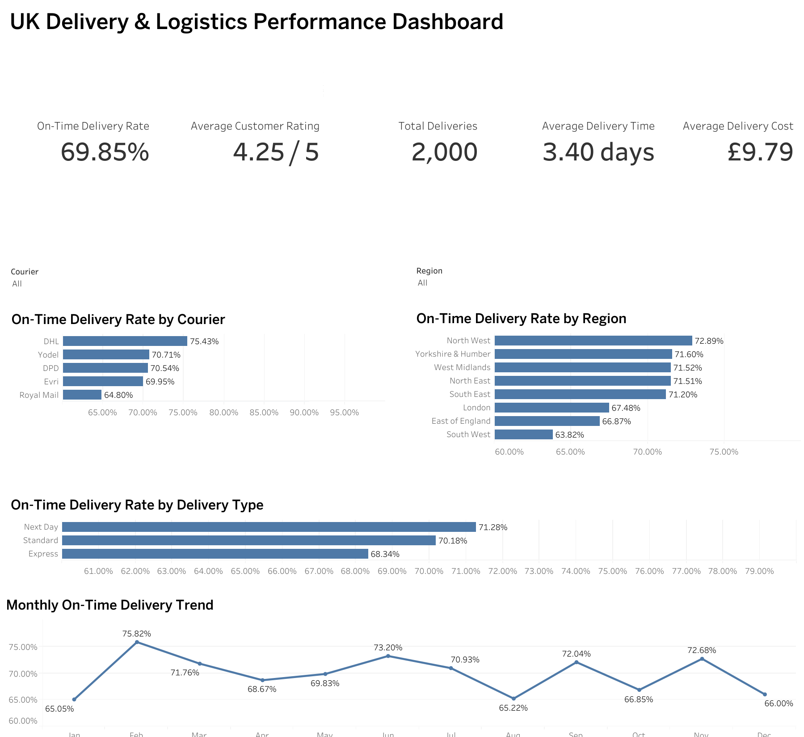
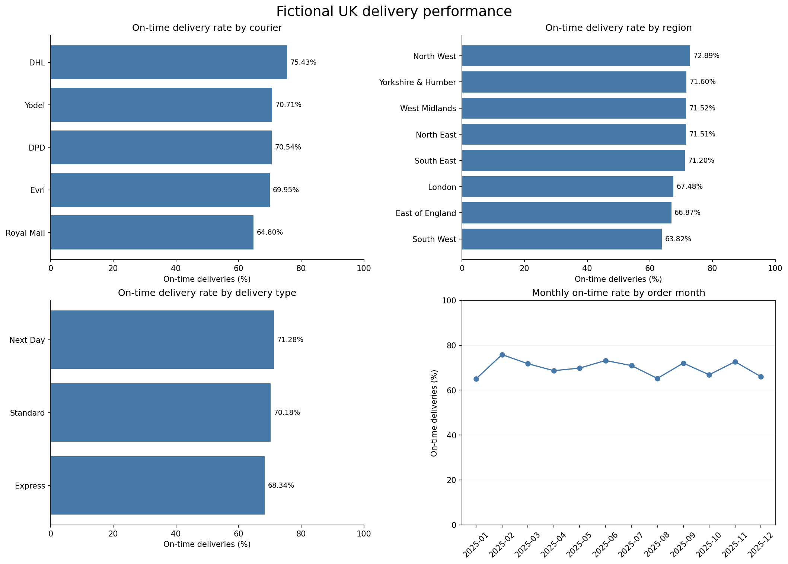

# UK Delivery and Logistics Performance Analysis

Python and Tableau analysis of 2,000 fictional UK delivery records. This portfolio project covers data validation, cleaning, feature engineering, operational KPIs and visual analysis.

**Provenance:** The Python notebook was reconstructed with ChatGPT assistance on 23 October 2026 after the original notebook was found empty. The rebuilt code was executed and its exported data reconciled with the supplied cleaned reference. This is not a recovered original notebook. Dataset findings are fictional and do not represent actual courier performance or commercial achievements.

## Verified KPIs

| Metric | Result |
|---|---:|
| Deliveries | 2,000 |
| On-time delivery rate | 69.85% |
| Average delivery time | 3.40 calendar days |
| Average delivery cost | £9.79 |
| Average customer rating | 4.25 / 5 |
| Recorded ratings | 1,968 |

## Cleaning and methods

- Standardise courier labels by trimming whitespace and matching case-insensitively.
- Parse four date columns and validate order, dispatch and delivery sequence.
- Fill 18 missing distances with the observed median of 53.7 km.
- Retain 32 missing ratings; average ratings exclude them.
- Calculate dispatch-to-delivery days, days late, on-time status and order month.
- Export an 18-column cleaned CSV and compare every field with the supplied reference across all 2,000 rows.

On-time means delivery on or before its promised date. All records have the required dates. The 53.7 km median is an imputation assumption, not a recovered measurement. Group comparisons do not establish causes; one year of fictional data cannot establish recurring seasonality.

## Files

| File | Purpose |
|---|---|
| `delivery_analysis.ipynb` | Executed reconstructed notebook with explanations and saved outputs |
| `delivery_logistics_data.csv` | Original fictional dataset |
| `delivery_logistics_cleaned.csv` | Notebook-generated output for Tableau |
| `delivery_logistics_cleaned_reference.csv` | Supplied cleaned file retained only for reconciliation |
| `UK_Delivery_Logistics_Performance_Dashboard.twbx` | Supplied Tableau packaged workbook |
| `dashboard.png` | Supplied Tableau dashboard preview |
| `python_analysis.png` | Charts generated by the reconstructed notebook |
| `requirements.txt` | Python analysis dependencies |

## Run

Keep all files together. Install the packages in `requirements.txt` in your Python environment, open the notebook in Jupyter or VS Code with a Python kernel, and run cells from top to bottom. The analysis uses the original raw CSV; the reference CSV is used only by the final reconciliation cell. Running the notebook overwrites the generated cleaned CSV and Python chart image in this project folder.

The uploaded notebook includes outputs saved after the candidate ran all eight code cells locally in VS Code. The final saved output confirms that all 18 columns match the supplied reference across 2,000 deliveries, with no saved error outputs. Package versions are not pinned; differences in future environments may need review. Tableau refresh and interactive behaviour have not been tested here.

## Python analysis preview

## Tableau presentation

The supplied dashboard reports the same headline KPIs. Its comparison bar axes start above zero, which exaggerates visual differences; use a zero baseline for the courier, region and delivery-type bars when updating Tableau. The Python charts use 0–100% axes. Clear Courier and Region filters before comparing headline totals.

## Skills demonstrated

Pandas data preparation, missing-data decisions, date arithmetic, NumPy conditional logic, grouped analysis, Matplotlib charts, CSV export, reconciliation and Tableau dashboard presentation. Review and understand the reconstructed implementation before discussing it in interviews.
